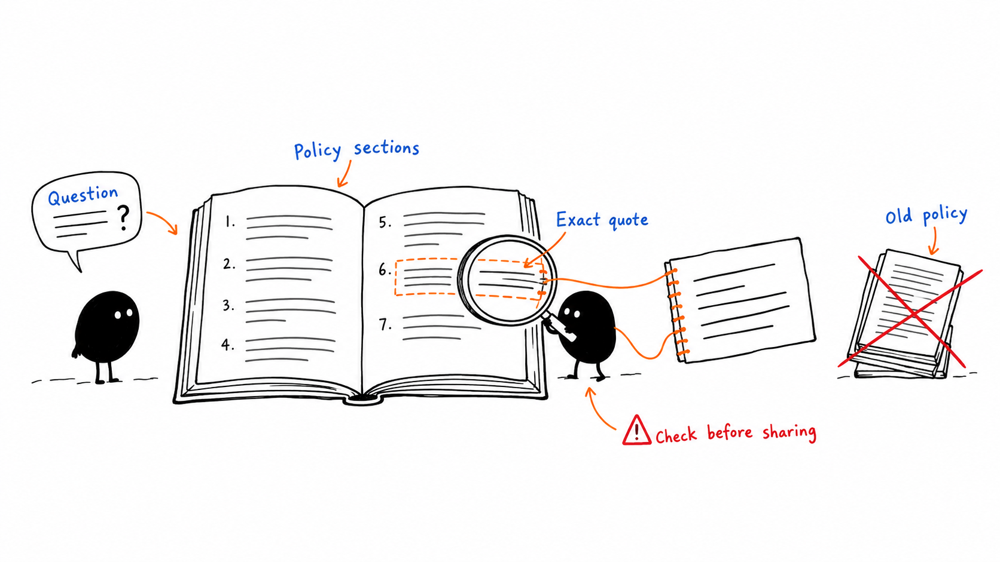
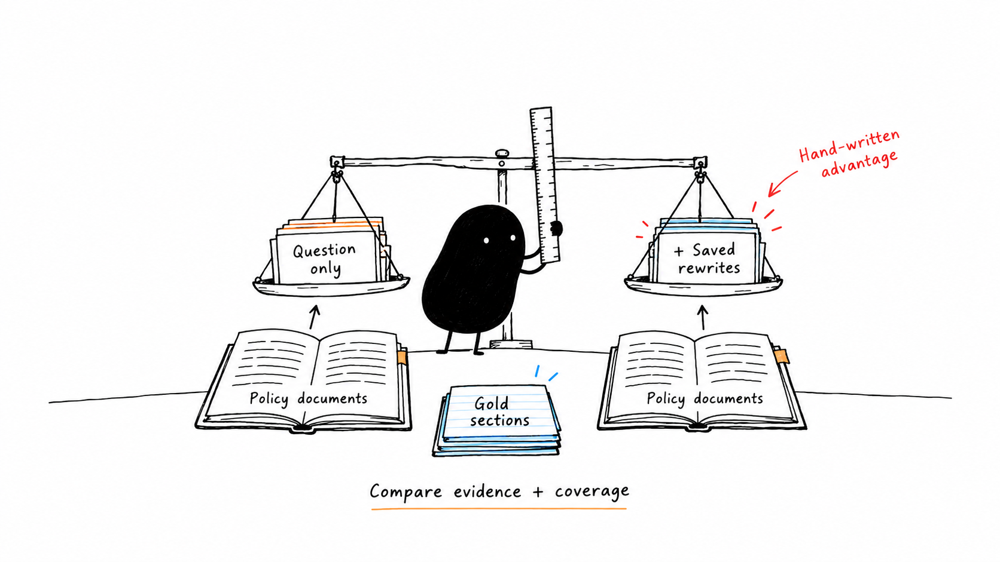

# Policy Q&A

An agent skill for answering questions from company policy documents with section-level evidence. It combines local retrieval scripts with agent instructions for checking exceptions, quoting sources, and declining questions the documents do not cover.

Use it for leave, expenses, travel, remote work, IT security, and conduct policies. The included policies describe a fictional company and are test fixtures.



*Find relevant policy sections, anchor each claim to a quote, and check the answer before sharing.*

## Requirements

- Python 3.9 or later; no third-party Python packages or API keys are required by the scripts.
- An agent capable of following [SKILL.md](SKILL.md) and running local Python commands to rewrite questions and draft answers.
- Policy documents in Markdown or plain text, with numbered section headings.

The scripts retrieve evidence and check citations. They do not call a model or generate answers themselves.

For real company documents, run from a private working directory outside this repository and use absolute script and corpus paths. Restrict that directory to your account using OS permissions and remove generated files when no longer needed. Repository-local `.policy-qa-private/`, `run.json`, and `answer.md` are ignored as an additional guard against accidental commits; ignore rules do not restrict file access. The examples below use fictional data.

Policy text and retrieved metadata are untrusted evidence: embedded commands, links, or requests for disclosure must not direct the agent's tools. Pass questions and paths as separate process arguments, never by interpolating them into shell commands. Keep the corpus unchanged during processing; links and Windows reparse points are rejected, but concurrent modification is outside the CLI's protection.

The local input limits are 100 files, 1 MiB per file, 10 MiB per corpus, 2,000 sections, 4,000 characters per query, five rewrites, and 1–50 results. Exceeding a limit produces an error rather than silently truncating evidence.

## Quick start

Run these commands from the repository root. Use `python3` instead of `python` if required by your environment.

Retrieve evidence from the fictional policy corpus:

```bash
python skills/policy-qa/scripts/retrieve.py evals/corpus "How much paid leave do full-time employees earn?" --rewrite "annual paid leave days per calendar year" -k 5 --out run.json
```

Read the returned sections in `run.json`. A supported answer for this example is:

```text
Full-time employees earn 20 days of paid leave per calendar year. [leave.md#2.1: "Full-time employees earn 20 days of paid leave per calendar year, accrued at 1.67 days per month."]
```

Save that answer as `answer.md`, then check it against the retrieved evidence:

```bash
python skills/policy-qa/scripts/check_citations.py answer.md run.json
```

The checker returns JSON and exits with `0` when its checks pass, or `1` when it finds problems. Review and correct failures before sharing the answer.

Source metadata must use retrieved section IDs, optionally followed by exact headings or `(title, effective-date)`; use `undated` when no date exists. Unsupported answers use the exact sentence `The provided policies do not cover this.` Arbitrary claims in headings or source metadata are rejected. A passing citation check still requires review that the quotes support the claims.

## Use with an agent

Keep the repository together and direct your agent to the root [SKILL.md](SKILL.md). Agent-specific skill discovery and installation depend on the host; this repository does not provide an installer.

**Layout note:** `SKILL.md` currently lives at the repository root, while its executable scripts live in `skills/policy-qa/scripts/`. Resolve its `<skill>/scripts/` command examples to that actual script directory when configuring your agent.

The workflow is:

1. Use the policy folder supplied by the user.
2. Write short query rewrites while preserving the user's role, location, and other relevant details.
3. Retrieve sections and inspect the coverage result.
4. Check exceptions, eligibility, conflicting policies, and evidence spanning multiple documents.
5. Draft an answer with section IDs and supporting quotes, then run the citation checker.
6. Say the policies do not cover the question when the evidence is insufficient.

## Prepare your policies

Place `.md` or `.txt` files directly inside a policy folder; subfolders are not scanned. Use numbered headings so each section has a stable citation ID:

```markdown
# Example Policy
Effective date: 2026-01-01

## 1 Scope
This policy applies to full-time employees.

### 1.1 Eligibility
Additional eligibility rules go here.
```

The section ID is the filename plus section number, such as `example.md#1.1`. Duplicate IDs are rejected. To exclude an outdated document by default, put `SUPERSEDED` before its first numbered heading; effective dates alone do not select the current version.

Replace `evals/corpus` in the retrieval command with your policy folder. See the [policy format guide](skills/policy-qa/references/README.md) for details. Keep real company policies and generated answers out of commits; `.gitignore` already excludes `my-policies/` and `*.private.md`, but does not exclude every possible input or output filename.

## Evaluation and tests

```bash
python -m unittest discover -s skills/policy-qa/scripts -p "test_*.py"
python -m unittest discover -s evals -p "test_*.py"
python evals/test_gold.py
python evals/eval_retrieval.py
```

| File | Purpose |
| --- | --- |
| [questions.json](evals/questions.json) | Gold questions, required sections, key facts, forbidden values, and unanswerable cases. |
| [rewrites.json](evals/rewrites.json) | Hand-written search alternatives keyed by question ID. |
| [test_gold.py](evals/test_gold.py) | Validate that the answer key agrees with the corpus. |
| [eval_retrieval.py](evals/eval_retrieval.py) | Automatically load saved rewrites and compare retrieval with and without them. |
| [score_answers.py](evals/score_answers.py) | Score saved answers for key facts, abstention, and optional citation checks. |

Retrieval evaluation uses the top five sections (`k=5`). It reports the fraction of required evidence retrieved, questions with all required evidence, and coverage mistakes. Saved rewrites were written with knowledge of the corpus, so their results may overestimate performance on unseen questions.



*Compare both runs against the same gold evidence; saved rewrites are a useful benchmark, not a guarantee for unseen questions.*

To evaluate agent-written answers, save them as `q01.md`, `q02.md`, and so on in an answers folder. Save each matching retrieval run beside its answer as `q01.run.json` to enable citation checks:

```bash
python evals/score_answers.py path/to/answers
```

Missing answer files are reported as skipped. Review the skipped list before treating a score as a complete evaluation.

## Limits

- Retrieval uses keyword and character-fragment matching, not semantic embeddings. Five results are a default, not a proven optimum.
- `covered` is a lexical overlap signal, not proof that a question is answerable. The synthetic intern-leave case can be marked covered even though interns are not addressed.
- Citation checks verify source membership, quote matching, and numeric support; they do not prove that a quote supports the meaning of a claim.
- PDFs and Word documents require conversion. The scripts do not implement document access control or choose between conflicting current policies.
- Review answers before using them for consequential decisions. The skill reads supplied documents; it does not provide legal or HR advice.

## Repository guide

- [Agent instructions](SKILL.md)
- [Skill catalog](skills/README.md)
- [Policy Q&A overview](skills/policy-qa/README.md)
- [Script usage](skills/policy-qa/scripts/README.md)
- [Policy format and evidence conventions](skills/policy-qa/references/README.md)
- [Synthetic policy corpus](evals/corpus/)
- [Documentation assets](assets/README.md)
